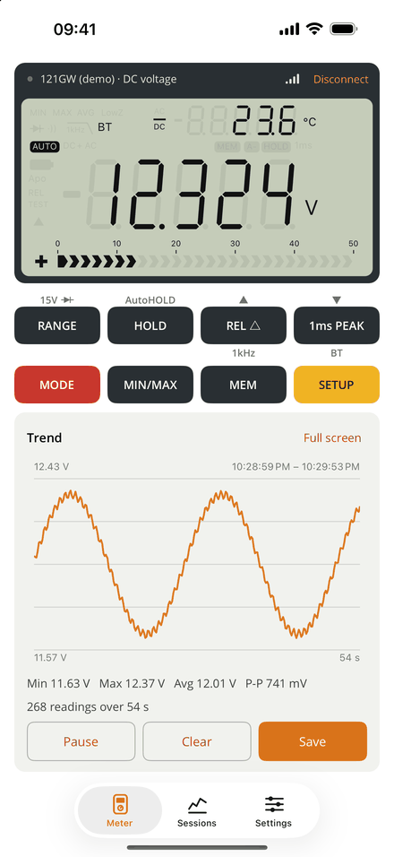
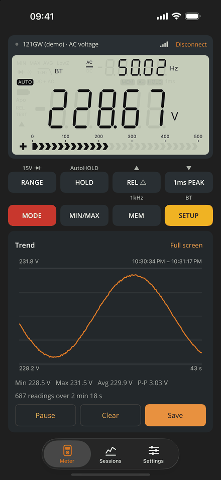
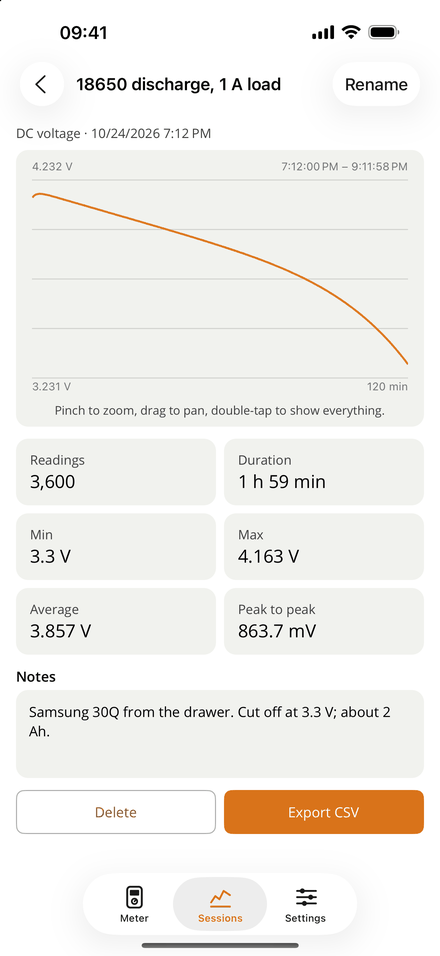
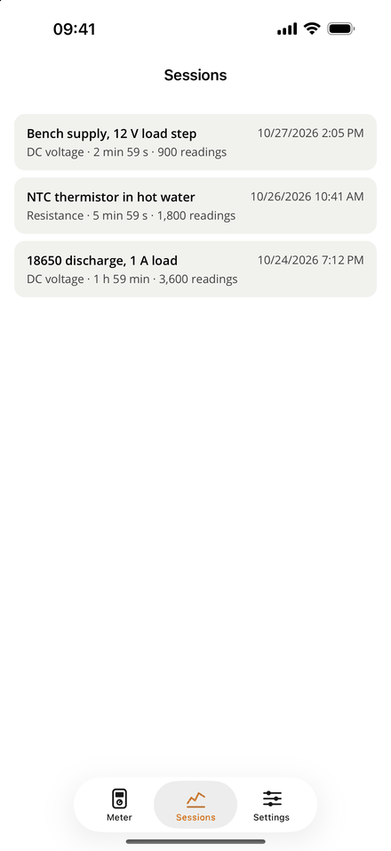
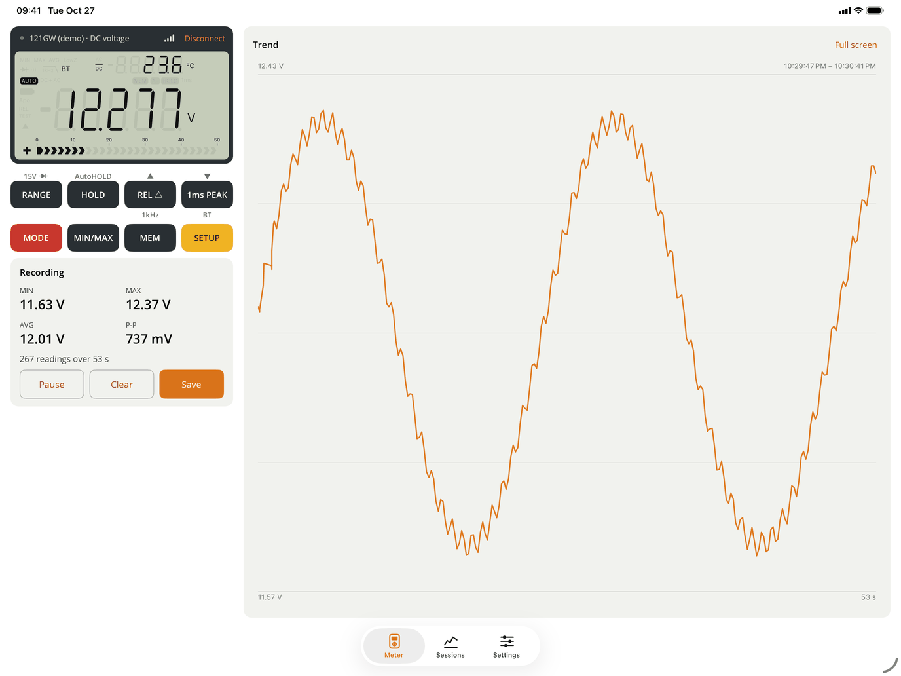
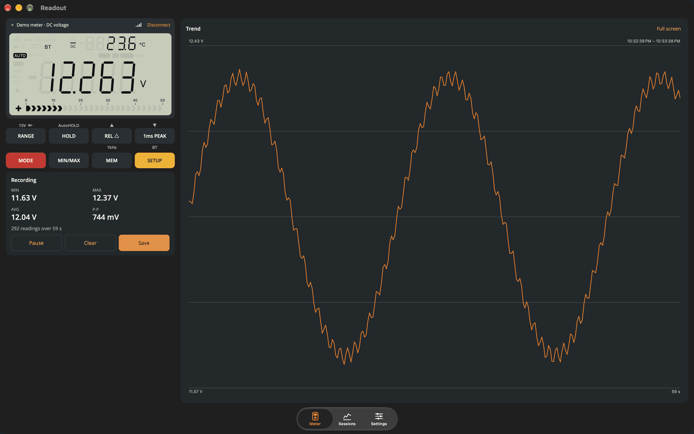

# Readout

A companion app for the **EEVblog 121GW** multimeter, for iPhone, iPad, Mac, Android and
Windows. Built with .NET 10 and .NET MAUI.

**[Website](https://amd989.github.io/readout/)** · [Support](https://amd989.github.io/readout/support.html) ·
[Privacy](https://amd989.github.io/readout/privacy.html) · [The 121GW](https://www.eevblog.com/product/121gw/)

<p>
  
  
  
  
</p>



- **Live LCD.** A drawing of the meter's display: main and sub readings, units, the bar graph
  and every symbol.
- **Remote buttons.** Press any of the meter's eight buttons from the app, short or long.
- **Logging.** Every reading is logged while connected, with a live trend graph and
  min/max/average/peak-to-peak. Logging keeps running with the screen locked (iOS), and the
  recording is kept on disk, so closing the app doesn't lose it.
- **Readable graphs.** The meter screen shows the last 10 minutes; full screen shows the whole
  recording, with long recordings drawn as an average line over a min/max band. Pinch to
  zoom, drag to pan.
- **Saved sessions.** Save a recording with a name and notes; each keeps its graph and
  statistics.
- **CSV export.** Timestamped readings in SI units, ready for a spreadsheet.
- **Continuity beep.** In continuity and resistance modes the phone beeps and vibrates below
  a threshold you set, with hysteresis so it doesn't chatter.
- **Signal and battery.** The connection line shows the meter's signal strength and battery.
- **Reconnects by itself** to the last meter when it comes back in range (can be turned off
  in Settings).
- **Demo meter.** Try the app without a meter (simulated readings).
- **Works with Claude (Mac and Windows).** An optional, local-only MCP server lets an AI
  assistant read the meter, look at recent readings, press buttons and save sessions. See
  [docs/MCP.md](docs/MCP.md).

> Readout is an independent, open-source project. It is not made, endorsed or supported
> by EEVblog. 121GW and EEVblog are trademarks of their owners.

## Platforms

| Platform | Status |
|---|---|
| iOS / iPadOS 15+ | ✅ |
| macOS (Mac Catalyst) 12+ | ✅ |
| Android 6+ | ✅ |
| Windows 10/11 | ✅ builds on Windows |
| Linux | Planned: `Readout.Core` is plain .NET, ready for a Linux front end (see below) |

## Repository layout

| Path | What |
|---|---|
| `Readout.Core/` | Everything about the meter that isn't UI or a Bluetooth stack: packet parsing, LCD decoding, key commands, logging and CSV, the simulated meter. Plain `net10.0`. |
| `Readout.Mcp/` | The MCP server for AI assistants: the tools and a small loopback HTTP host, on the official MCP C# SDK. Plain `net10.0`. |
| `Readout/` | The .NET MAUI app: Bluetooth through Plugin.BLE, view models, pages, the LCD and graph drawings. |
| `Readout.Tests/` | xUnit tests for the core. |
| `docs/PROTOCOL.md` | The 121GW Bluetooth protocol, documented. |
| `docs/` | Also the GitHub Pages site (`index.html`, `privacy.html`, `support.html`) and the web screenshots. |
| `store/` | Full-size App Store screenshots. |

## Building

You need the .NET 10 SDK and the MAUI workload (`dotnet workload install maui`), plus Xcode
for Apple targets and the Android SDK for Android.

```bash
dotnet test --project Readout.Tests
```

```bash
dotnet build Readout -f net10.0-ios
```

```bash
dotnet build Readout -f net10.0-maccatalyst
```

```bash
dotnet build Readout -f net10.0-android
```

On Windows, `-f net10.0-windows10.0.19041.0`.

Simulators and emulators have no Bluetooth. Debug builds running on one use the simulated
meter when you scan (set `READOUT_FAKE_BLE=1` to do that anywhere). Every build also has
**Try the demo meter** on the connect screen.

## Publishing

`./publish-ios.sh` builds the signed iPhone/iPad `.ipa` and refuses it if any binary carries a
slice other than arm64, which App Store Connect rejects. `./publish-mac.sh` builds the signed
Mac App Store `.pkg` (Apple silicon and Intel). Upload with Transporter.



## Linux

.NET MAUI has no Linux support today. Everything that knows about the meter lives in
`Readout.Core`, which has no MAUI or Bluetooth dependency: a Linux app needs a UI and an
`IMeterConnection` over BlueZ. Avalonia's MAUI backend may make the existing app run on Linux
directly once it is stable.

## Credits

The meter protocol comes from the official EEVblog 121GW app by David Ledger (MIT). See
[THIRD_PARTY_NOTICES.md](THIRD_PARTY_NOTICES.md).

## License

[MIT](LICENSE). Privacy: [PRIVACY.md](PRIVACY.md) (no data collected).
